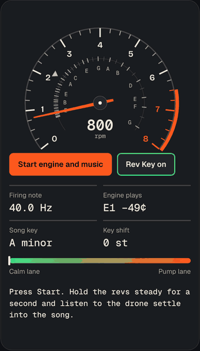
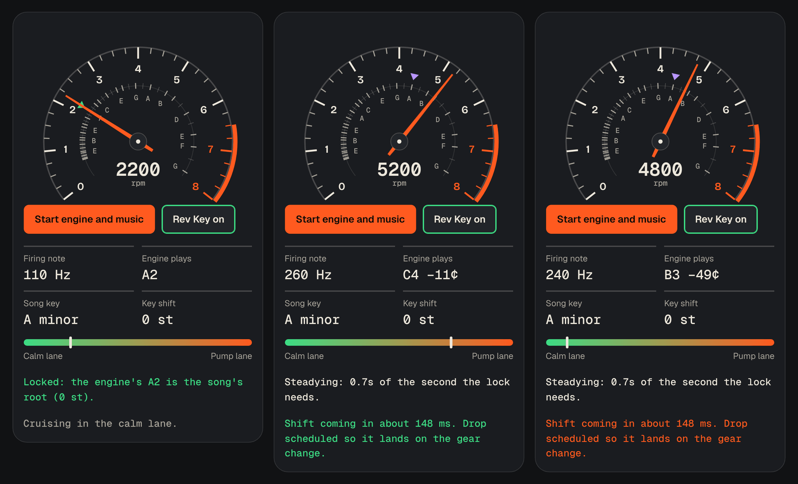
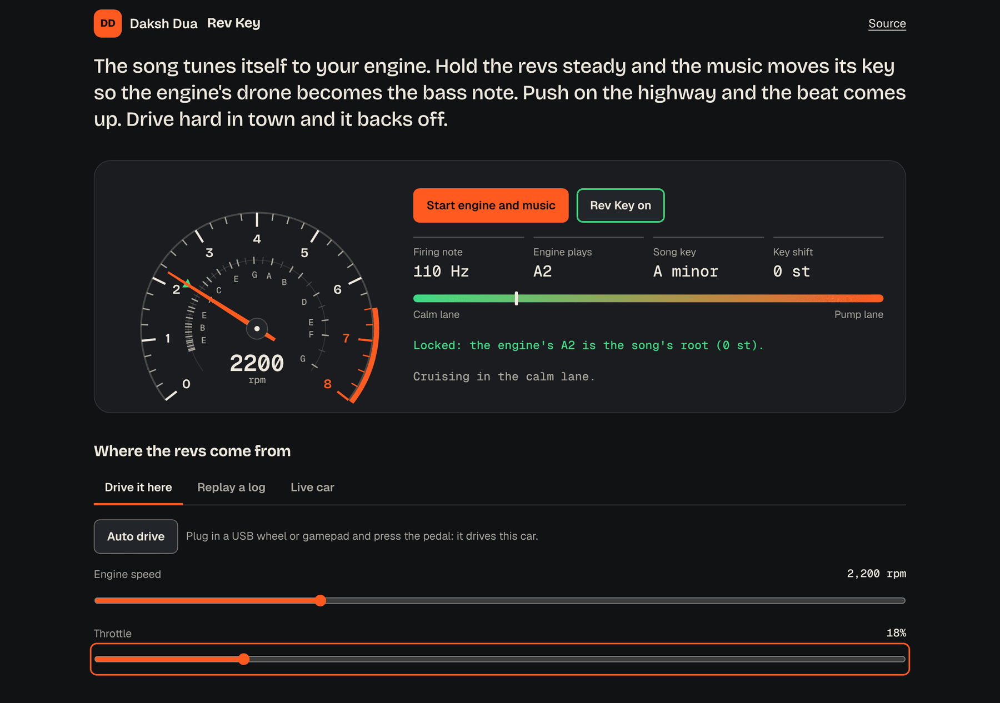

# Rev Key

**The song tunes itself to your engine.**

[**Try it live**](https://daksh2197.github.io/rev-key/) in any browser. Free, no sign-up, works with no signal. Headphones or a speaker, and press Start.

[](https://github.com/daksh2197/rev-key/actions/workflows/ship.yml)
[](LICENSE)

<p align="center">
  
</p>

An engine at a steady speed is a note. A V6 at 2,200 rpm fires 110 times a second, which is an A. At highway cruise that note sits under every song you play for an hour, and most of the time it is a semitone off the bass line. You can hear the clash without knowing why. Rev Key fixes the why: it reads the revs, works out the note, and moves the song's key so the engine lands on the root.

## Why I built it

Cars have had music that gets louder when you accelerate for years. Factory systems do it, phone apps do it. None of them do the thing my ear kept asking for on the highway, which is to make the engine and the music agree on a key.

I'm a car person with a V6 project car and an OBD-II adapter already plugged into it, so the numbers were sitting right there: engine speed, several times a second. The rest is music theory and a bit of scheduling. It started as a one-page demo with two sliders. This is the finished version: a tested core, three ways to feed it revs, and a counter in the middle that reads notes as well as thousands.

## What it does

- **Reads the engine as a note.** Firing frequency from RPM and cylinder count, shown in hertz and as a note name with cents. The counter's inner ring puts the notes where they sit on the dial.
- **Locks the key.** Hold the revs steady for a second and the song moves by the smallest shift (two semitones at most) that puts its root or fifth on the engine's note. Move the revs and it lets go. A marker shows where the root sits; it turns green on the needle when the lock engages.
- **Mixes two lanes by how you drive.** A calm lane for cruising and a pump lane that opens with revs and throttle on the highway.
- **Counter-steers.** Hard throttle or high revs in the city, or any speed over the posted limit, sends the mix back to the calm lane and lowers the volume. The volume cap is yours; nothing in the app can raise it.
- **Lands the drop on the gear change.** It learns the RPM you shift at and, given the delay of your speaker, books the beat drop early enough to reach the speaker when the revs fall, not after.
- **Takes revs from three places.** Sliders and an auto-drive script, the pedals of a USB racing wheel or gamepad, a recorded Open Gauge log replayed parked, or a live car over Bluetooth LE OBD-II (read only; Chrome or Edge on Android, Windows, macOS or ChromeOS).
- **Keeps everything on the device.** No server, no account, no tracking. Settings live in the browser's local storage. Open it once and it is saved for use with no signal.



## The note in 30 seconds

```
firing Hz   = RPM / 60 × cylinders / 2          (four-stroke)
note        = 69 + 12 × log2(firing Hz / 440)    (MIDI number; 69 is A4)
key shift   = smallest move, within ±2 semitones, that puts the song's root or fifth on that note
```

A V6 at 2,200 rpm: 110 Hz, note 45, an A2. The demo song is in A minor, so the shift is 0. Drop to 2,150 rpm (what most cars actually settle at) and the engine is 0.4 semitones flat of A; the song follows it down 0.4 so the drone sits dead on the root. Cruise at 2,330 rpm and the engine is an A#; the song moves up one. Hold 2,620 rpm, a C, and the nearest root or fifth is three semitones away: out of reach, the song keeps its key and the screen says so.

The long version, with the lanes and the shift prediction, is in [docs/THE-MATH.md](docs/THE-MATH.md).



## Run it yourself

You need [Node.js](https://nodejs.org) 22.12 or newer.

```bash
git clone https://github.com/daksh2197/rev-key.git
cd rev-key
npm install
npm run dev     # the app, live-reloading, at http://localhost:5173
npm test        # 447 tests, in about five seconds
npm run build   # the finished site, in dist/
```

To hear it on a real car you need an ELM327-type Bluetooth LE adapter in the OBD-II port and a browser with Web Bluetooth. Set it up parked, pick a lane mode, then leave the phone alone. It is entertainment software, not a driving aid.

## How it's built

| Piece | Job | Why this one |
| --- | --- | --- |
| TypeScript | The language | It catches "you passed a word where a number goes" before the app runs |
| Vite | Builds the site | One command, under a second |
| Vitest and fast-check | Runs the tests | Example tests for the cases I thought of; property tests invent hundreds of drives for the rules that must hold for all of them |
| Web Audio API | The sound | Built into every browser. Notes are booked 120 ms ahead on the audio clock, so a slow frame never bends the beat |
| Web Bluetooth and the Gamepad API | Car and wheel | Also built in. No app store, no driver, nothing installed |
| No framework | The screen | One screen. The app's JavaScript is 18 kB compressed |
| GitHub Actions and Pages | Test, then deploy | Every push to main runs the tests. If one fails, nothing ships |

The map:

```
src/
  core/             the brain: no screen, no audio, just numbers and words
    engine.ts       RPM to firing frequency to note. Start here.
    keylock.ts      steady detection, the smallest shift, hold and release
    lanes.ts        calm and pump, counter-steer, the volume rule
    shift.ts        seeing a gear change, foreseeing the next one
    patterns.ts     the two beats as data, and the look-ahead scheduler's one decision
    sim.ts          a small car with a five-speed automatic, the auto-drive script, pedal maths
    replay.ts       an Open Gauge log, replayed parked
    words.ts        every sentence the app says
    *.test.ts       the tests, next to the code they check
  obd/              the adapter: ELM327 commands, PIDs, Web Bluetooth, a scripted fake (from Open Gauge)
  audio/
    rig.ts          the mixer and the scheduler
    voices.ts       nine small instruments
  ui/
    tach.ts         the rev counter with the note ring
    pedal.ts        a wheel's pedals, learned not configured
  main.ts           wires a source to the core and the core to the rig and the screen
  styles/brand.css  the dakshdua.ca colours, in one file
public/sw.js        the offline worker
.github/workflows/ship.yml   test, then deploy
```

Want the guided tour? [docs/CTO-NOTES.md](docs/CTO-NOTES.md) explains every idea in here in plain English, how to debug it, and five small changes to try. The money side is in [docs/BUSINESS.md](docs/BUSINESS.md).

## What got caught along the way

- **A beat drop that landed late.** The first version played the drop the moment it saw the revs fall. By the time the sound came out of a Bluetooth speaker, the shift was a quarter of a second old. The fix is in `shift.ts`: it learns where you shift from the shifts it has seen, draws a line through the last third of a second of revs, and fires early when the line crosses that point inside the speaker's lead time. The test for it climbs from 3,000 to 6,000 rpm and checks the event comes about 250 ms before 5,800.
- **A dial that labelled every note.** An octave is a doubling of RPM, so notes bunch up at low revs: between 800 and 1,600 rpm there are twelve of them. The first ring was a smear of letters on the left. Now a name is only written where there is eleven degrees of room since the last one.
- **A page that would not fit a small phone.** At 320 pixels wide the page scrolled sideways by 18 pixels. The cause was the longest option in the engine menu, "Three cylinder, four-stroke", which set the menu's minimum width and pushed the whole grid out. A browser check at five widths caught it; the fix is three lines of CSS.
- **A lock that engaged on the way past.** An early steady-detector compared each sample with the last one, so a slow climb through a note counted as steady. It now needs the whole last second of revs inside an 80 rpm band. The property test feeds it two hundred random samples and checks it never shifts further than the limit and never reports a shift while unlocked.

## How this was built

I build with Claude as my pair programmer. I bring the problem and decide what the thing should do. Claude writes most of the code. I review it until I can explain every file, and [the CTO notes](docs/CTO-NOTES.md) are my study guide, in public. Every commit carries the co-author line.

## What's next

- [ ] Drive it. The live-car path reuses the adapter code from my Open Gauge build, tested against a scripted adapter, not yet in the car. Rev Key itself has only run on recorded logs and the sim so far.
- [ ] Your own music. The two beats are synthesized placeholders because they have to change key on demand. Real tracks need per-stem pitch shifting, which is a bigger piece of work.
- [ ] A measured speaker delay instead of a slider: play a click, listen on the microphone, read the gap.
- [ ] iPhone. Safari has no Web Bluetooth, so the live-car source needs a different route there.

Ideas and pull requests are welcome. If the counter reads a note your engine is not making, [open an issue](https://github.com/daksh2197/rev-key/issues) with the RPM and the cylinder count.

## License

[MIT](LICENSE). Use it, fork it, wire it into your own dashboard.

Built in Calgary by [Daksh Dua](https://dakshdua.ca).
